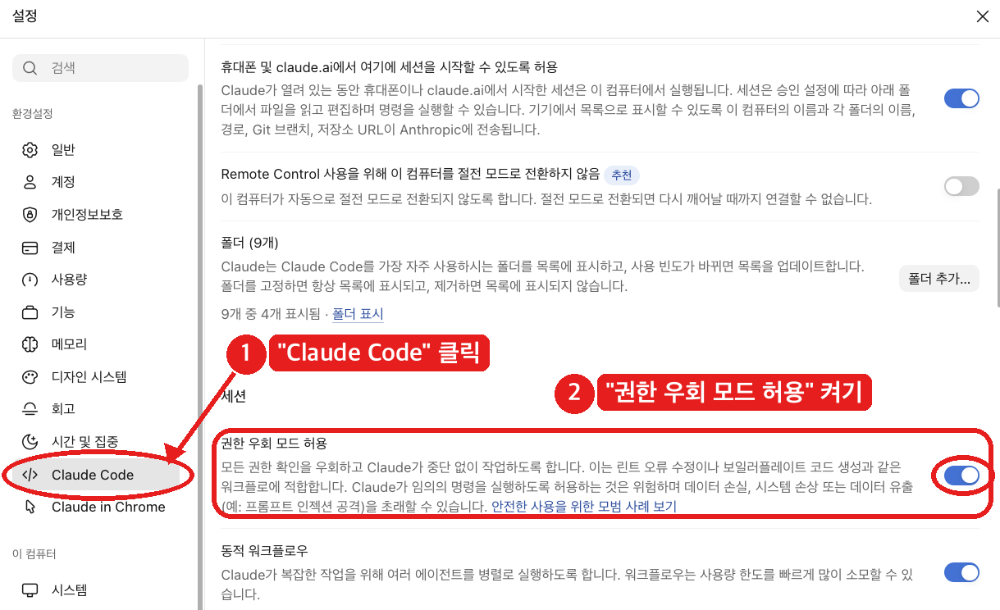

# 바이브 코딩 특강 준비물 안내

안녕하세요, 올리몰리입니다.
이번 특강에서는 제가 드리는 바이브 코딩 플러그인으로 같이 실시간으로 앱을 하나 만들어 봅니다.

- 아래 준비물은 **수업 중에 같이 코딩해 보고 싶으신 분들만** 준비하시면 됩니다.
- 보기만 하실 분은 준비 없이 들어오셔도 괜찮아요!
- 따라 하실 분은 수업 시간에 설치하다 보면 시간이 금방 가니까, **꼭 미리 해 와 주세요.**

📅 **일시: 11월 15일 (일) 오전 9시 (한국 시간) · 줌**

---

## ✅ 준비 순서 (15분)

### 1. 노트북 또는 데스크톱 (맥 또는 윈도우)

- 태블릿, 크롬북은 따라 하기 어려워요

### 2. AI 도구 유료 구독 — Claude 또는 Codex 중 하나

- **Claude** — Pro 또는 Max. 무료 플랜으로는 Claude Code를 쓸 수 없어요 (https://claude.com/pricing)
- **Codex** — ChatGPT 유료 플랜 (Plus 이상). Codex 는 ChatGPT 앱 안에 들어 있어요
- 수업 화면은 Claude 로 보여 드려요. Codex 도 같은 흐름으로 따라올 수 있어요

### 3. 설치 스크립트 한 번 실행하기

명령 한 줄이 아래 일을 **처음부터 끝까지 한 번에** 해 줘요.

0. 처음에 **Claude / Codex** 중 내가 쓸 도구를 골라요 (↑↓ + 엔터, 또는 숫자 1 / 2)
1. Claude 데스크톱 앱 또는 ChatGPT 앱(Codex 포함) 설치
2. Git, Node.js 22, Firebase CLI 설치
3. Firebase 로그인
4. 묻지 않고 실행하도록 설정 — Claude 는 "권한 우회 모드 허용", Codex 는 Full access
5. Firebase 콘솔 열기 (약관 동의용)

이미 설치된 건 버전을 확인하고 건너뛰니까 **여러 번 실행해도 괜찮아요.**

#### 윈도우

1. 키보드에서 **윈도우 키(⊞) + R** 을 같이 누르세요 → "실행" 창이 떠요
2. 아래 한 줄을 복사해서 붙여 넣고 **[확인]**

```
powershell -NoProfile -ExecutionPolicy Bypass -Command "irm https://raw.githubusercontent.com/team-keroro/vibe-coding-setup/main/setup-windows.ps1 | iex"
```

3. 파란 창 또는 검은 창(PowerShell)이 뜨고 설치가 시작돼요. **창을 닫지 말고** 기다려 주세요
4. **"이 앱이 디바이스를 변경할 수 있도록 허용하시겠어요?"** 창이 뜨면 **[예]** (Git, Node.js 설치할 때 한 번씩)
   - 오래 멈춘 것 같으면 화면 아래 작업 표시줄에서 깜빡이는 방패 아이콘을 눌러 보세요

#### 맥

1. **⌘ + 스페이스** → "터미널" 검색해서 열기
2. 아래 한 줄을 복사해서 붙여 넣고 **엔터**

```
/bin/bash -c "$(curl -fsSL https://raw.githubusercontent.com/team-keroro/vibe-coding-setup/main/setup-mac.sh)"
```

3. **"명령어 라인 개발자 도구"** 설치 창이 뜨면 **[설치] → [동의]** (Git 이 없을 때만)
4. **"Password:"** 가 나오면 맥 로그인 비밀번호를 치고 엔터
   - 비밀번호는 쳐도 화면에 안 보이는 게 정상이에요

#### 중간에 Firebase 로그인 (윈도우·맥 공통)

설치가 끝나면 같은 창에서 Firebase 로그인이 시작돼요.

1. 영어로 **"Allow Firebase to collect ... (Y/n)"** 라고 물으면 **`n`** 치고 엔터 (Y를 눌러도 괜찮아요)
   - 그 밖에 영어로 (Y/n) 질문이 더 나오면 그냥 엔터
2. 브라우저가 저절로 열리면 **내 구글 계정 선택 → [허용]**
3. 브라우저에 "Firebase CLI Login Successful" 이 나오면 원래 창으로 돌아오세요

#### 끝나면

창에 **MISSION COMPLETE** (맥은 **"설치가 모두 끝났어요!"**) 와 버전 세 줄이 나오면 성공! 캡처해 두세요.

```
node -v            → v22.23.5
git --version      → git version 2.56.1.windows.1
firebase --version → 15.36.0
```

(숫자는 조금 달라도 괜찮아요. Node는 맨 앞이 v20 이상이면 OK!)

### 4. 스마트폰

- 다 만든 앱을 내 폰으로 열어 보는 순간이 있어요

---

## 📝 스크립트가 끝난 뒤 내가 직접 할 일

스크립트가 끝나면 Claude 앱과 브라우저(Firebase 콘솔)가 열려 있어요. 아래를 하나씩 체크해 주세요.

- [ ] **Claude 앱에 로그인하기** — 2번에서 구독한 계정으로
- [ ] **Firebase 콘솔에서 약관 동의하기** — 열린 브라우저에서 동의만 하면 돼요. 프로젝트는 만들지 않아도 돼요 (https://console.firebase.google.com)
- [ ] **"권한 우회 모드 허용" 이 켜져 있는지 확인하기** — 스크립트가 켜 두지만 한 번만 봐 주세요. 꺼져 있으면 직접 켜면 돼요
  1. Claude 앱 설정 열기 (왼쪽 아래 내 이름 → "설정")
  2. ① 왼쪽 메뉴에서 **"Claude Code"** 클릭
  3. ② "세션" 칸의 **"권한 우회 모드 허용"** 스위치가 파란색이면 OK

  

  - 켜 두면 AI가 일할 때마다 "이거 해도 될까요?"를 묻지 않고 쭉 진행해서, 수업 따라가기가 훨씬 편해요
  - 대신 AI가 묻지 않고 실행하니, 수업용으로 만든 폴더에서만 쓰세요
- [ ] **버전 세 줄 캡처해 두기** — 수업 때 막히면 이걸 보여 주시면 돼요
- [ ] **수업 당일 줌 + Claude 앱 켜 두기**

**Codex 를 고른 분은** 위 Claude 항목 대신 이렇게 해 주세요.

- [ ] **ChatGPT 앱에 로그인하기** — 유료 ChatGPT 계정으로. 앱에서 **Codex** 를 고르세요
- [ ] **Codex 권한 확인하기** — Codex 입력창 아래 권한이 **Full access** 인지 봐 주세요. 스크립트가 `~/.codex/config.toml` 에 `approval_policy = "never"`, `sandbox_mode = "danger-full-access"` 를 넣어 둬요 (원래 파일은 `.bak` 으로 남겨요). 이것도 수업용 폴더에서만 쓰세요
- [ ] **수업 당일 줌 + ChatGPT 앱(Codex) 켜 두기**

---

## 🙅 필요 없는 것

- 코딩 지식: 하나도 없어도 됩니다
- 신용카드: 무료 범위 안에서만 만들어요
- GitHub 계정: 없어도 돼요

---

## 💡 막히면

- **브라우저가 안 열리면:** 창에 나온 긴 주소(`https://...`)를 복사해서 브라우저에 붙여 넣으세요
- **"Already logged in as ..."** 가 나오면 이미 Firebase 에 로그인된 거예요. 그대로 OK!
- **빨간 글씨로 "문제가 생겼어요"** 가 나오면: 한 번 더 실행해 보세요. 이미 끝난 단계는 건너뛰어요
- 그래도 안 되면 창을 캡처해서 Claude 앱에 "설치하다가 이런 화면이 나왔어. 어떻게 해?" 라고 물어보세요
- 그래도 안 되면 단톡방에 저를 태그해서 캡처와 함께 남겨 주세요

수업 날 뵙겠습니다!

---

## 스크립트가 하는 일

| 파일 | 하는 일 |
| --- | --- |
| [`setup-windows.ps1`](setup-windows.ps1) | 윈도우용. 먼저 Claude / Codex 를 고르고, 없는 것만 설치해요: Claude 앱(downloads.claude.ai 공식 설치 파일) 또는 ChatGPT 앱(Codex 포함, Microsoft Store `9PLM9XGG6VKS`), Git(git-for-windows 공식 설치 파일), Node.js 22(nodejs.org 공식 MSI), Firebase CLI(`npm install -g firebase-tools`). 그다음 `firebase login` 실행, Claude 설정 켜기, Firebase 콘솔 열기 |
| [`setup-mac.sh`](setup-mac.sh) | 맥용. Git(Xcode 명령어 라인 도구), Node.js 22(nodejs.org 공식 .pkg), Firebase CLI, Claude 앱(downloads.claude.ai 공식 파일) 또는 ChatGPT 앱(Codex 포함, OpenAI 공식 파일) 순서로 없는 것만 설치하고 나머지는 윈도우와 같아요. Homebrew 는 쓰지 않아요 |
| [`reset-windows.ps1`](reset-windows.ps1) | 윈도우용 되돌리기. 체크박스로 고른 것만 지워요: Firebase 로그인 해제, Firebase CLI, Node.js(+ npm 전역 폴더), Git, "권한 우회 모드 허용" 끄기, Claude 앱, Claude 앱 데이터. 지우기 전에 한 번 더 물어봐요 |
| [`setup-windows.cmd`](setup-windows.cmd), [`reset-windows.cmd`](reset-windows.cmd), [`setup-mac.command`](setup-mac.command) | (선택) 위 한 줄 명령이 권장 방법이에요. 파일로 받아 더블클릭하고 싶으면 이 저장소를 ZIP 으로 받아 압축을 푼 폴더에서 실행하세요. 맥에서 "확인할 수 없음" 창이 뜨면 [완료] → 시스템 설정 → 개인정보 보호 및 보안 → 맨 아래 [그래도 열기] |

**Claude 설정 변경에 대해:** 스크립트는 Claude 앱의 설정 파일 `claude_desktop_config.json` 에서 `preferences.bypassPermissionsModeEnabled` 값 하나만 `true` 로 바꿔요. 바꾸기 전 파일은 같은 폴더에 `.bak` 으로 남겨 둬요. 이 값은 설정 화면의 "권한 우회 모드 허용" 스위치와 같아요. 실제로 그 모드를 쓸지는 Claude 앱에서 직접 고르고, 처음 고를 때 앱이 보여 주는 경고도 직접 확인하게 돼요.

모든 설치 파일은 각 프로그램의 공식 서버에서 직접 받아요. 내용이 궁금하면 위 파일을 열어 보세요.

---

## 🧹 다 지우고 처음으로 되돌리고 싶으면 (윈도우)

설치 스크립트로 깐 것들을 지우는 스크립트예요. 수업이 끝나고 정리하고 싶을 때나, 처음부터 다시 설치해 보고 싶을 때 쓰세요.

1. **윈도우 키(⊞) + R** → 아래 한 줄을 붙여 넣고 **[확인]**

```
powershell -NoProfile -ExecutionPolicy Bypass -Command "irm https://raw.githubusercontent.com/team-keroro/vibe-coding-setup/main/reset-windows.ps1 | iex"
```

2. 화살표 키(↑↓)로 고르고 **엔터**
   - **전부 삭제** — Claude 앱까지 모두 지워요
   - **Claude 빼고 삭제** — Claude 앱과 로그인은 그대로 두고 나머지만 지워요
   - **직접 고르기** — 지울 것만 하나씩 체크해요
3. 다음 화면에서 **스페이스바**로 체크를 켜고 끌 수 있어요 → **엔터**
4. **"정말 지울까요?"** 에 **`y`** → 지우기 시작해요 (Node.js, Git 을 지울 때 **[예]** 창이 한 번씩 떠요)

- 지운 건 되돌릴 수 없어요. 다시 쓰려면 위의 설치 스크립트를 한 번 더 실행하면 돼요
- 그만두려면 **`Q`** 를 누르세요. 아무것도 지우지 않아요
- 지우지 않고 화면만 미리 보고 싶으면:

```
powershell -NoProfile -ExecutionPolicy Bypass -Command "$env:VIBE_DEMO='1'; irm https://raw.githubusercontent.com/team-keroro/vibe-coding-setup/main/reset-windows.ps1 | iex"
```
